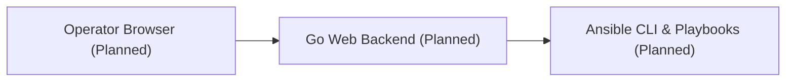

# GTAnsible

Early prototype repository scaffold (`v0.1.0`) for a planned **Web interface for Ansible** licensed under GNU GPL v3.0 ([`LICENSE`](LICENSE)).

> **Documentation Portal:** [docs/index.md](docs/index.md) ([Tutorials](docs/01-tutorials/index.md), [How-To Guides](docs/02-how-to-guides/index.md), [Reference](docs/03-reference/index.md), [Explanation](docs/04-explanation/index.md))

## Repository Status

**GTAnsible** is currently an initial documentation and license scaffold (`28e555e Initial commit` baseline). Application source files (`go.mod`, `*.go`), web frontend assets, and Ansible playbooks are **not yet implemented**.



## Actual Repository Inventory

| File / Directory | Status | Purpose |
| :--- | :--- | :--- |
| [`README.md`](README.md) | Present | Repository overview, status disclosure, and verification commands |
| [`LICENSE`](LICENSE) | Present | GNU General Public License v3.0 (`674` lines) |
| [`.gitignore`](.gitignore) | Present | Go binary/test/workspace/.env ignore rules plus Python cache ignores |
| [`docs/`](docs/index.md) | Present | English Diátaxis documentation portal (`Tutorials`, `How-To`, `Reference`, `Explanation`) |
| [`tests/`](tests/test_docs_tutorials_howtos.py) | Present | Automated `unittest` validation of repository artifacts, Diátaxis, STE, links, and Mermaid |
| Go backend / Web UI / Playbooks | Not implemented | Reserved for future feature milestones |

## Verify the Repository

Run the repository verification suite from the root directory:

```bash
python3 -m unittest discover -s tests -p "test_*.py" -v
```
