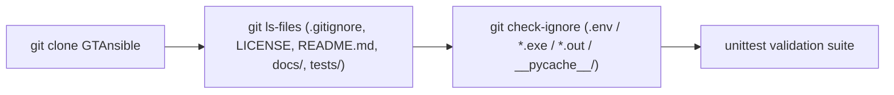

# Tutorial 1: Inspect the Prototype Scaffold and Verify Baseline Rules

In this tutorial, you inspect the tracked files inside **GTAnsible**, confirm the GPL-3.0 license and `.gitignore` protections, and run the automated repository test suite.

> **Scope Note**: **GTAnsible** currently contains documentation, license, `.gitignore`, and tests only. No application code or Ansible playbooks exist in this `v0.1.0` baseline.

## Prerequisites

- `git` installed locally.
- Python 3 installed locally to run the verification tests.

## Step 1: List Tracked Files and Inspect the License

From the root of your clone, check tracked files and verify the `LICENSE` header:

```bash
git ls-files
head -n 5 LICENSE
```



Expected header lines:

```text
                    GNU GENERAL PUBLIC LICENSE
                       Version 3, 29 June 2007
```

## Step 2: Verify Secret and Build Artifact Ignore Rules

Confirm that Git ignores sensitive `.env` configuration files and Go build binaries configured in `.gitignore`:

```bash
git check-ignore -v .env server.exe profile.cov
```

Expected output includes matching lines from `.gitignore` (`line 28: .env`, `line 5: *.exe`, `line 18: profile.cov`).

## Step 3: Run the Automated Verification Suite

Execute the repository test suite from the root directory:

```bash
python3 -m unittest discover -s tests -p "test_*.py" -v
```

Expected summary: `OK` with zero failures.

## Next Steps

- Follow step-by-step checks in [How to Verify the Scaffold and Local Ignore Rules](../02-how-to-guides/verify-scaffold-and-prepare-env.md).
- Inspect exact file specifications in [Repository Files and .gitignore Reference](../03-reference/repository-files-and-gitignore.md).
- Read planned architecture context in [Prototype Baseline and Planned Design](../04-explanation/prototype-baseline-and-planned-design.md).
