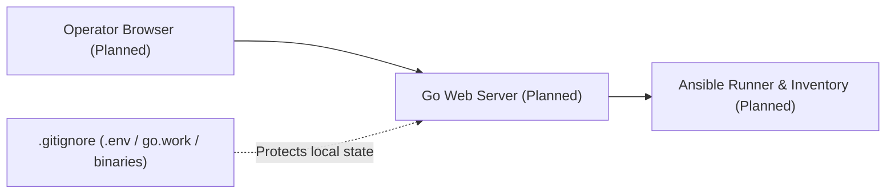

# Prototype Baseline and Planned Design

**GTAnsible** is preserved at an early `v0.1.0` repository initialization state (`28e555e Initial commit`). Documenting that baseline transparently prevents new contributors from expecting runnable server endpoints or Ansible playbooks before implementation lands.

## Planned Architecture Signal (Inferred from Repository Scaffold)

Although no runtime code exists yet, two committed clues indicate the intended direction:

1. **README intent**: States `"Web interface for Ansible"`.
2. **Go `.gitignore` template**: Includes Go binary (`*.exe`, `*.test`), coverage (`*.coverprofile`), and workspace (`go.work`) rules rather than Node.js or Python framework ignores.

## Licensing Boundary (`GPL-3.0`)

The repository ships with GNU General Public License v3.0 (`LICENSE`). Any future Go packages, web UI templates, or Ansible integration modules distributed from this codebase remain governed by GPL-3.0 copyleft requirements unless explicitly dual-licensed by copyright holders.

- Exact tracked file list and `.gitignore` rules: [Reference](../03-reference/repository-files-and-gitignore.md).
- Operational scaffold checks: [How to Verify the Scaffold and Local Ignore Rules](../02-how-to-guides/verify-scaffold-and-prepare-env.md).
