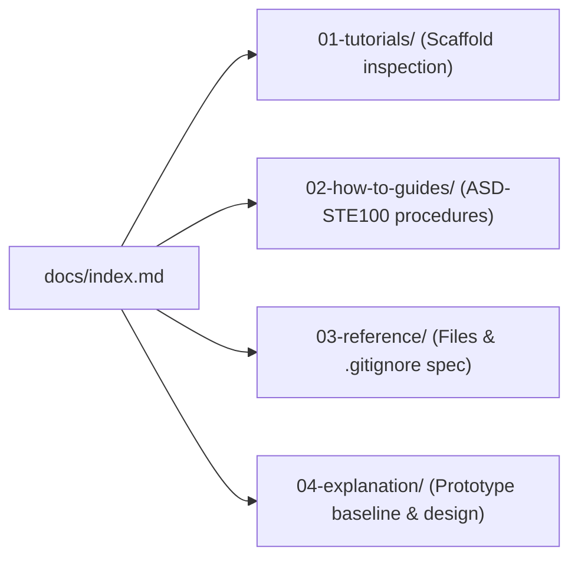

# GTAnsible Documentation Portal

Documentation portal for the **GTAnsible** prototype repository (`v0.1.0`), organized using the **Diátaxis** framework.

> **Repository Overview:** [README.md](../README.md)

## Quadrants

| Quadrant | Purpose | Entry Point |
| :--- | :--- | :--- |
| **Tutorials** | Guided inspection of repository files and local dev checks | [01-tutorials/index.md](01-tutorials/index.md) |
| **How-To Guides** | Goal-oriented operational checks (ASD-STE100 Issue 9) | [02-how-to-guides/index.md](02-how-to-guides/index.md) |
| **Reference** | Exact inventory of tracked files, `.gitignore` rules, and unimplemented scope | [03-reference/index.md](03-reference/index.md) |
| **Explanation** | Prototype baseline rationale, license scope, and planned Go/Ansible flow | [04-explanation/index.md](04-explanation/index.md) |
